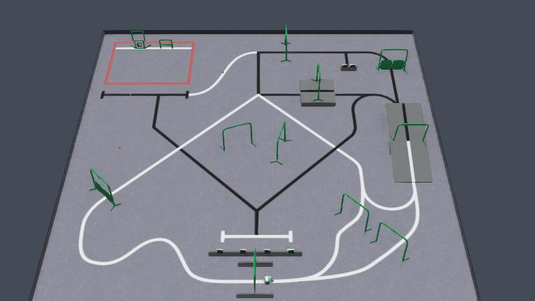

# RoboCup.dk 2026 – Webots Simulation

This repository contains a Webots simulation of the **RoboCup.dk 2026** competition track.

## Running the Simulation

1. Download and install Webots from https://cyberbotics.com/.  
   The simulation was developed using **Webots R2025a**, but newer versions should also work.
2. Open the file `worlds/robocup.dk_2026.wbt` in Webots.
3. Start the simulation by pressing the **Play** button.
4. The simulation includes a simple robot that can be controlled using the keyboard arrow keys. Speed can be set with keys **`1`** to **`9`**.
   It also has a basic line-following algorithm that can be enabled by pressing the **`L`** key.

The robot is controlled by the `controllers/boebot_controller/boebot_controller.py` Python script. You can use this as a starting point for your own robot, or simply to learn how to use Webots. A simple improvement is to make the robot able to follow the black line.

## Track Rules and Setup

During the competition, several obstacles on the track will be manually randomized.  
These include elements such as the **seesaw angle**, **free gates**, and **ball placement**.

In the simulator, this randomization occurs automatically when the robot passes the **start line**. At the same time, the **timed door**, **fitness obstacle**, and **locked door obstacle** are reset.

You can also manually trigger this randomization process by pressing the **`R`** key. This allows you to reset and randomize the track without needing to drive the robot back to the start line.

The track behavior is controlled by the `controllers/controlled_obstacles/controlled_obstacles.py` script. You can experiment with or disable parts of this script to make it easier to test your own robot algorithms.
